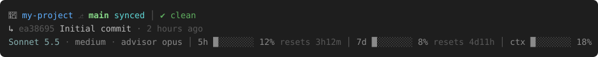
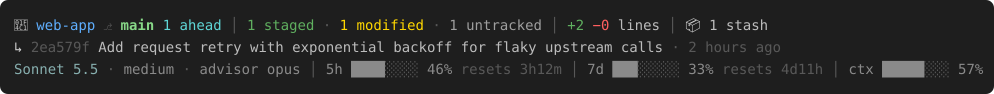
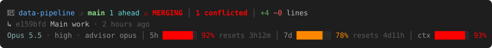

# Claude Code status line

My [Claude Code](https://claude.com/claude-code) status line: three compact lines showing git state,
the last commit, and model / plan-usage meters. Pure bash (+ `jq`, `git`); git output is cached so it never lags.

## Preview

Rendered from the real script output (`tools/render-previews.sh`).

**Healthy** – clean repo, low usage



**Busy** – staged / modified / untracked files, stash, commits ahead



**Critical** – merge conflict, usage limits nearly exhausted



<details><summary>Plain-text fallback</summary>

```
📁 web-app ⎇ main 1 ahead │ 1 staged · 1 modified · 1 untracked │ +2 −0 lines │ 📦 1 stash
↳ 7037ee3 Add request retry with exponential backoff for flaky upstream calls · 2 hours ago
Sonnet 5.5 · medium · advisor opus │ 5h ████░░░░ 46% resets 3h12m │ 7d ███░░░░░ 33% resets 4d11h │ ctx █████░░░ 57%
```
</details>

### What each line shows

| Line | Content |
|---|---|
| 1 | 📁 repo · ⎇ branch · sync (`synced` / `N ahead` / `N behind` / `no upstream`) · `⚠ MERGING/REBASING/CHERRY-PICKING` · staged/modified/untracked/conflicted counts or `✔ clean` · `+ins −del` lines · 📦 stash count |
| 2 | `↳` last commit hash, subject (wrapped to 2 lines, 110 cols), age |
| 3 | model · effort · advisor model │ `5h` and `7d` rate-limit bars with reset countdown │ `ctx` context-window usage |

### Colors

| Color | Meaning |
|---|---|
| blue / green | repo name / branch |
| teal | in sync, ahead |
| green · yellow · gray | staged · modified · untracked |
| red | conflicts, merge/rebase in progress, usage ≥ 90% |
| orange | behind upstream, usage ≥ 75% |
| gray (muted) | model, effort, usage meters below 75% |

## Install on a new machine

Requirements: `bash`, `git`, `jq` (`sudo apt install jq` / `brew install jq`).

```bash
git clone <this-repo-url> cc-status-line
cd cc-status-line
./install.sh
```

`install.sh` copies the script to `~/.claude/statusline-command.sh` and merges the `statusLine` key from
`settings.statusLine.json` into `~/.claude/settings.json` (existing keys kept, backup saved as `settings.json.bak`).
Restart Claude Code afterwards.

### Manual install

1. `cp statusline-command.sh ~/.claude/ && chmod +x ~/.claude/statusline-command.sh`
2. Add to `~/.claude/settings.json`:
   ```json
   "statusLine": { "type": "command", "command": "bash ~/.claude/statusline-command.sh" }
   ```

### Try it without installing

```bash
./preview.sh            # or: ./preview.sh busy | critical
```

## Tuning

Edit the variables at the top of `statusline-command.sh`: `COMMIT_WIDTH`, `COMMIT_LINES`, `CACHE_FRESH`, `CACHE_STALE`
and the palette. The advisor model is read from `advisorModel` in the project/user `settings.json`.
Fields missing from Claude Code's status JSON (e.g. `rate_limits` on API-key auth) are simply hidden.

## Repo layout

| Path | Purpose |
|---|---|
| `statusline-command.sh` | the status line script |
| `settings.statusLine.json` | `statusLine` settings snippet |
| `install.sh` / `preview.sh` | installer / live preview |
| `fixtures/` | sample Claude Code status JSON used for previews |
| `tools/` | `render-previews.sh`, `ansi2svg.py` – regenerate `docs/` |

After editing the script in `~/.claude`, copy it back here, run `tools/render-previews.sh`, and commit.
